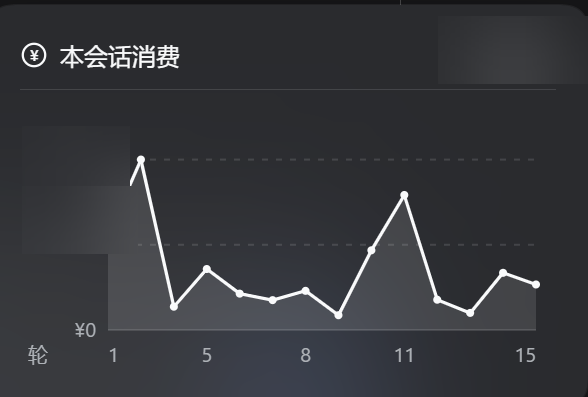
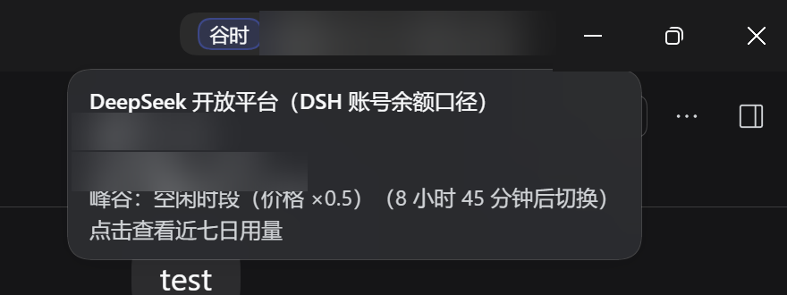
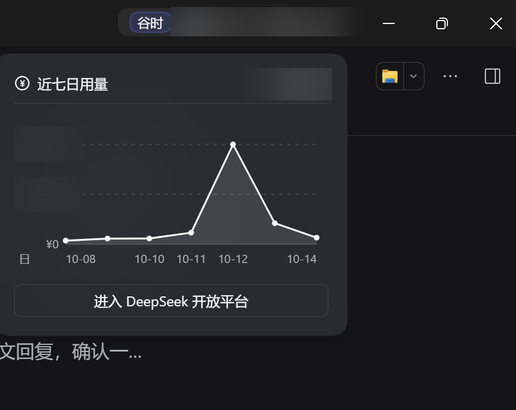
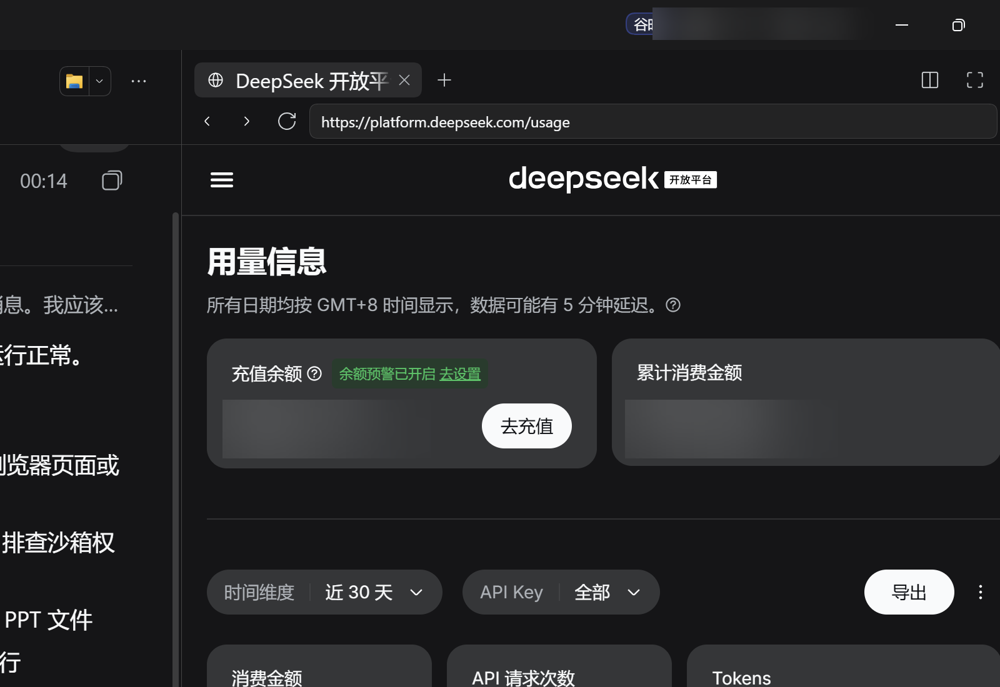

# dsh-session-cost

简体中文 | [English](README.en.md)

给 [DeepSeek Harness](https://github.com/deepseek-ai)（DSH）桌面版加一条「花了多少钱」的实时反馈：**输入框底栏的会话总消费**、**每条回复的本轮消费**、**窗口右上角的账号余额与今日用量（含峰谷提示）**。

会话金额按 DSH 自己的会话日志逐轮重算（覆盖插件启用之前的历史轮次），不依赖任何第三方插件。

## 功能

| 位置 | 显示 | 交互 |
| --- | --- | --- |
| 输入框底栏（token 用量之后） | `本会话 ¥ 6.42`（可切成 `本会话 12 积分`） | 点击弹出**每轮消费折线图**；面板底部可切换底栏口径 |
| 每条回复的动作栏（官方「用量 N tok」右侧） | `¥ 0.28` | 与官方用量按钮同款样式，悬停看该轮明细 |
| 窗口右上角（标题栏右侧） | `谷时 余额 ¥ 42.00 · 今日 ¥ 3.21` | 点击弹出**近七日每日用量折线图** + 「进入 DeepSeek 开放平台」按钮（用 DSH 侧栏浏览器打开，保留登录态） |

悬停小窗全部为自绘的深色浮层（背景模糊与会话消费面板同一套），不是系统原生 tooltip。

### 截图

> 下面的截图里，余额与消费金额数字已做模糊处理。

会话总消费 + 每轮消费曲线：



每条回复右侧的本轮金额（官方用量按钮右边）：


右上角余额 / 今日用量，以及峰谷提示：



点击后弹出近七日每日用量：



「进入 DeepSeek 开放平台」走 DSH 侧栏浏览器（持久分区，登录一次即可）：



## 安装

> 需要 DSH 桌面版（开发环境为 Windows 上的 `DSH Desktop 2.0.17`）。插件是纯 Cordis 插件，宿主半边 + 浏览器半边各一个文件。

1. 把本仓库放进 DSH 的插件目录：

   ```powershell
   git clone https://github.com/<你>/dsh-session-cost.git "$env:USERPROFILE\.dsh\plugins\dsh-session-cost"
   ```

   macOS / Linux 对应 `~/.dsh/plugins/dsh-session-cost`。

2. 在 profile 里登记（`~/.dsh/profiles/desktop/package.json`）：

   ```jsonc
   {
     "dependencies": {
       // …… 其他插件
       "dsh-session-cost": "link:C:/Users/<你>/.dsh/plugins/dsh-session-cost"
     },
     "dsh": {
       "profile": {
         "bundles": [
           // …… 其他 bundle
           "dsh-session-cost"
         ]
       }
     }
   }
   ```

3. 在 `~/.dsh/profiles/desktop/node_modules/` 下建一个指向插件目录的链接（Windows 用 Junction，macOS / Linux 用符号链接；在 profile 目录里跑一次 `npm install` 也行）：

   ```powershell
   New-Item -ItemType Junction `
     -Path   "$env:USERPROFILE\.dsh\profiles\desktop\node_modules\dsh-session-cost" `
     -Target "$env:USERPROFILE\.dsh\plugins\dsh-session-cost"
   ```

4. 重启 DSH。

插件被删掉/禁用时界面会立刻少掉这三处显示，不会影响会话本身。

### 生效方式（改代码时）

**改完统一重启 DSH** —— DSH 桌面版没有页面刷新入口：

| 改了什么 | 怎么生效 |
| --- | --- |
| `lib/client.js`（界面半边） | 重启 DSH |
| `lib/index.js`（宿主半边） | 重启 DSH |

`Ctrl+R` / `F5` / `Ctrl+Shift+R` 在 DSH 桌面版里无效，别在它们身上浪费时间。另外宿主会缓存已经加载过的客户端脚本，所以就算你的环境提供了页面刷新，改完 `lib/client.js` 也建议直接重启。

## 配置

### `DSH_HOME`

宿主读取 `process.env.DSH_HOME`，没有就用 `~/.dsh`。会话日志、记账账本、自定义单价都在这下面。

### 自定义单价（可选）

如果 `.dshw-api.json` 存在（[dsh-whale-widget](https://github.com/MeteorNOX/DeepSeek-Balance-Whale-Widget) 写的那个文件），本插件会**只读**地复用其中的自定义单价与汇率：

```jsonc
// ~/.dsh/.dshw-api.json
{
  "models": [
    {
      "id": "deepseek-v4-pro",
      "matchIds": ["deepseek-v4-pro", "v4-pro"],   // 关键字长度需 ≥ 3
      "price": { "hit": 0.15, "miss": 4.5, "out": 13.5, "cur": "USD", "rate": 7.2 }
    }
  ]
}
```

金额单位是「每百万 token」。`cur` 非 `CNY` 时用 `rate` 折算成人民币。

### 峰谷与节假日

单价表（`lib/index.js` 顶部）给的是**高峰时段**价，非高峰时段按 ×0.5 计：

- 高峰：工作日 `09:00–12:00`、`14:00–18:00`（北京时间）
- 谷时：其余时间 + **周末** + **法定节假日**（`WEEKEND_VALLEY_FROM_SEC` / `HOLIDAY_VALLEY`）

节假日表是硬编码的（当前到 2026 年），**每年需要按国务院公告更新**，否则会把节假日算成高峰价。

## 计价口径

### 会话金额（底栏 / 每轮）

直接解析 DSH 的会话日志，不看内存计数，因此**包含插件安装之前的历史轮次**：

```
~/.dsh/sessions/<工作区编码>/<会话 id>/session.v4.jsonl.zstd
```

- 文件是**多帧拼接的 zstd**（魔数 `28 B5 2F FD`），代码按帧切分逐帧解压，并做增量读取（只解析新增字节，半帧留到下次）；
- 只取 `assistant/message` 事件，用 `data.usage.{inputTokens,cacheReadTokens,outputTokens}`、`data.message.source.model`、事件时间；
- 按 `turn:step` 覆盖式去重（与 DSH 自己的 token 投影同口径）；
- 单价：`未缓存输入 × miss + 缓存读取 × hit + 输出 × out`，再按**该轮写入时刻**判断峰谷（×1 / ×0.5）。

### 余额与今日用量（右上角）

- 有 `DEEPSEEK_API_KEY` 凭据时，优先请求官方 `GET https://api.deepseek.com/user/balance`（结果带 `total_balance` / `currency`）；
- 否则退回 DSH 账号自身的余额（充值 + 赠金，即网页端口径）；
- **今日用量按余额差累计**：每 60 秒采样一次，余额**下降**的部分计入当天，充值（余额上升）不计负数；跨天时把当天用量归档进 history 并重置基准；
- 也就是说它是「当天所有渠道扣掉的总额」，与底栏「本会话 ¥」的 `token × 单价` **口径不同，不能相加**。

### WorkBuddy 积分（底栏可选口径）

装了 [dsh-workbuddy-connect](https://github.com/corrinehu/dsh-workbuddy-connect) 并把 WorkBuddy 模型接进 DSH 后，底栏可以切成显示**本会话消耗的积分**（面板底部一行「底栏金额：人民币 / WorkBuddy 积分」点击切换，选择记在浏览器本地存储里）：

- 数据来自该插件的本机只读接口 `GET /plugins/dsh-workbuddy-connect/status`（约每分钟取一次），不接触 WorkBuddy 的任何密钥或凭据；
- WorkBuddy 只提供**账号级**积分，没有按会话或按轮次的账单，所以这里是**估算**：把相邻两次采样的积分差累加起来；
- 对账按套餐包逐个比对：**新发放的积分**加回来、**到期作废的积分**扣掉，避免把这类账变当成消耗；积分周期重置等未识别的账变不计负消耗；
- 同一账号在别处（WorkBuddy 桌面版、其它 DSH 会话）的消耗会一起算进来，所以这个数是**上限**；
- WorkBuddy 走的是订阅配额，插件对 DSH 上报的单价为 0，按官方单价算出来的 `¥` 本来就没有真实依据 —— 这种情况用积分口径更诚实。

## HTTP 接口

两个只读路由，都只放行本机 Host（`localhost` / `127.x` / `[::1]`，其它一律 403），无需鉴权：

```
GET /dsh-session-cost/session-cost.json?session=<会话 id>
→ { ok, session, currency, cost, tokens, steps, turns, models[], days[], turnCosts[], updatedAt }

GET /dsh-session-cost/platform.json[?refresh=1]
→ { ok, balance, currency, source, todayUsage, days[{day,cost}], knownDays,
    peak, peakUntilMs, error, updatedAt }
```

`source` 为 `apikey`（官方余额接口）或 `account`（DSH 账号余额）；`days` 是近 7 天升序补零。

## 目录结构

```
dsh-session-cost/
├── package.json          # name / exports / dsh.bundle.patch / dsh.client
├── cordis.patch.yml      # bundle 层声明
├── lib/
│   ├── index.js          # 宿主：价目表、峰谷/节假日、日志解析、记账、两个只读路由
│   └── client.js         # 浏览器：底栏金额、每轮折线图、每条回复金额、右上角余额与面板、自绘 tooltip
├── docs/images/          # README 用截图
└── test/                 # 离线测试（从源码里截取真身函数来跑，无需 DSH）
```

## 开发与测试

```powershell
# 任意 Node.js ≥ 20（要带 zstd 支持）即可；DSH 自带的那个也可以：
#   %USERPROFILE%\.dsh\dsh-runtimes\dsh-primary-runtime\dependencies\node\bin\node.exe
node test/test_session_cost_plugin.mjs   # 路由、日志解析、计价、客户端契约
node test/test_platform.mjs              # 余额采样/跨天结转/近七日/峰谷判定
node test/test_tooltip.mjs               # 悬停小窗
node test/test_turn_cost.mjs             # 每条回复金额的注入
node test/test_chart.mjs                 # 折线图坐标与标签
node test/test_panel_place.mjs           # 面板定位
node test/test_workbuddy.mjs             # WorkBuddy 积分：快照拍平、差值对账、文案
```

测试脚本会从 `lib/*.js` 里截取**真身函数**执行（`new Function` 注入桩），所以改实现的同时断言会立刻反映出来。

## 已知限制

- 峰谷节假日表需要每年手动更新；
- 会话日志解析假设 `session.v4.jsonl.zstd` 的多帧格式没有变化（DSH 升级后可能失效）；坏帧连续失败 3 次就跳过该帧；
- 右上角余额的具体口径取决于你 DSH 的登录方式（API key 还是账号）；
- 只在 Windows 的 DSH 桌面版上实测过；浏览器半边用的是 DSH 的客户端插件通道，其他平台理论上一致；
- WorkBuddy 积分是**账号级估算**（同账号别处的消耗会算进来），不是按会话的账单；没装 `dsh-workbuddy-connect` 或未登录时，积分口径显示 `本会话 -- 积分`。

## 许可

[MIT](LICENSE)
